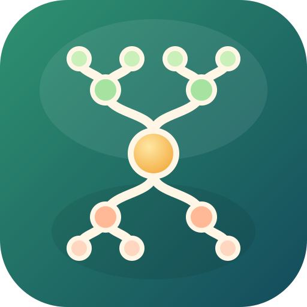

# Familien

Application d'arbre généalogique qui fonctionne sur **iPhone, Android et PC**, à partir d'un fichier brut de généalogie dans **Google Sheets**.

Tapez le nom d'une personne : Familien affiche son **arbre complet**, avec tous ses **ascendants** (au-dessus) et tous ses **descendants** avec leurs conjoints (en dessous).

## Fonctionnement

- **Local d'abord** : le fichier est enregistré sur l'appareil. L'application fonctionne ensuite **sans connexion**.
- **Le Drive n'est contacté que sur demande** : bouton « Drive » en haut, ou vérification au démarrage (option désactivable dans les réglages).
- **Alerte de modification** : si le fichier a changé sur le Drive, une alerte indique combien de personnes ont été ajoutées / modifiées / supprimées, et vous **acceptez ou non** la mise à jour. Si vous refusez, un point orange rappelle qu'une nouvelle version existe.
- Fiche de chaque personne (dates, lieux, profession, notes, parents, conjoints, enfants, frères et sœurs) en touchant sa case.
- **Trois vues** (menu déroulant « Vue » dans la barre du bas) ; les frères et sœurs restent dans l'ordre de naissance :
  - *Arbre* : la vue classique ;
  - *Intermédiaire* : enfants sans descendants affichés empilés en colonne, parents resserrés juste au-dessus de leur enfant ;
  - *Compacte*, idéale sur téléphone : descendants en liste verticale, ancêtres « en escalier » (côté paternel à gauche, maternel à droite), les deux parents juste au-dessus de la personne.
  - *Chêne* : l'arbre dessiné comme une gravure ancienne, ancêtres dans les racines, enfants dans les branches, dernière génération dans les feuilles, en calligraphie (polices IM Fell English et Pinyon Script, licence SIL OFL, dans `fonts/`).
  - *Chronologique* : éventail des descendants au-dessus, racines des ancêtres en dessous, et des cercles d'années (tous les 5, 10, 20 ou 25 ans) : les cousins nés la même année sont sur le même cercle ; les années inconnues sont estimées (~). Les couples sont réunis (descendant, date de mariage, conjoint) sur le tronc et à chaque nœud ; quatre racines partent du tronc (parents de la personne et de son conjoint) ; les branches se partagent la largeur de leur branche mère, sans raccord, et les nervures se prolongent du tronc jusqu'aux rameaux. Tronc et branches légèrement sinueux, avec des nœuds ; sous le sol, une coupe de terrain (strates, cailloux, vers de terre) et, à la surface, herbes, fleurs, fougères, champignons, un escargot et un lapin.
  - *3D* : l'arbre chronologique en volume, à faire tourner du doigt (ou à la souris) et à zoomer en pinçant. La hauteur suit l'année de naissance, avec les cercles d'années ; les familles se répartissent tout autour du tronc et les ancêtres forment les racines, sous le sol. Un écriteau en bois est suspendu à chaque embranchement (descendant, date de mariage, conjoint) ; le toucher rapproche la caméra et ouvre la fiche (celle du conjoint si l'on touche son nom). Le bouton d'export enregistre l'image vue à l'écran.
- **Lien entre deux personnes** : dans la fiche d'une personne, « Lien avec une autre personne… », puis choisir la 2e. L'application affiche uniquement le chemin qui les relie (ancêtre commun le plus proche, sinon descendant commun, sinon alliance) et nomme le lien (frère, nièce, cousin germain, grand-oncle…).
- Zoom au doigt (pincer) ou à la molette, nombre de générations réglable, export de l'arbre en image PNG ou SVG (pour imprimer).
- Thème clair / sombre automatique.

## Préparer le fichier Google Sheets

1. Une ligne par personne ; la première ligne contient les titres des colonnes.
2. Les colonnes sont **reconnues automatiquement** (titres en français ou en anglais) et peuvent être corrigées dans les réglages :

| Colonne | Exemples de titres reconnus |
|---|---|
| Identifiant | `ID`, `N°`, `Numéro`, `Réf` |
| Prénom / Nom | `Prénom`, `Nom`, ou `Nom complet` |
| Sexe | `Sexe`, `Genre` (H/M/F, Homme/Femme) |
| Naissance / Décès | `Date de naissance`, `Lieu de naissance`, `Décès`, `Lieu de décès` |
| Parents | `Père`, `Mère` (ou `Parents`) |
| Conjoint(s) | `Conjoint`, `Époux`, `Épouse` (plusieurs séparés par `;`) |
| Enfants (facultatif) | `Enfants` |
| Autres | `Profession`, `Notes`… toutes les autres colonnes sont affichées dans la fiche |

Les colonnes Père / Mère / Conjoint peuvent contenir **l'identifiant** de la personne (recommandé) ou son **nom complet** (« Jean Martin »).
Voir le fichier [`exemple.csv`](exemple.csv).

3. Accès au fichier : deux possibilités.
   - **Fichier privé (recommandé)** : l'application demande de se connecter à son compte Google (lecture seule). Seuls les comptes avec qui le fichier est partagé peuvent le charger. Nécessite un identifiant client Google, voir [Fichier privé : configuration Google](#fichier-privé--configuration-google).
   - **Fichier public** : *Partager → Accès général → Tous les utilisateurs disposant du lien (Lecteur)*. Toute personne ayant le lien peut alors le lire.

> 💡 Sans connexion Google : ouvrez le fichier dans le navigateur et enregistrez la page (format **.mht**, menu ⋮ → Télécharger dans Chrome Android), ou téléchargez-le en **.csv**, puis *Réglages → Importer un fichier*. Si le fichier importé diffère de votre copie, l'application montre les changements et demande votre accord.

> ⚠️ Le fichier doit être une vraie feuille **Google Sheets**. Pour un fichier Excel simplement déposé sur le Drive : l'ouvrir puis *Fichier → Enregistrer au format Google Sheets*.

## Fichier privé : configuration Google

À faire une seule fois (environ 10 minutes, gratuit), avec **n'importe quel compte Google** (le vôtre). Cela ne touche pas au fichier : il n'est pas nécessaire d'en être propriétaire, il suffit de pouvoir le lire.

1. Ouvrir https://console.cloud.google.com/ et **créer un projet** (par exemple « Familien »).
2. **Activer l'API** : menu *API et services → Bibliothèque*, chercher **Google Sheets API**, cliquer **Activer**.
3. **Écran de consentement** : menu *Google Auth Platform* (ou *Écran de consentement OAuth*) → **Commencer** :
   - nom de l'application : `Familien`, adresse e-mail d'assistance : la vôtre ;
   - audience : **Externe** ;
   - dans *Audience → Utilisateurs test*, **ajouter votre adresse Gmail** et celles des membres de la famille qui utiliseront l'application (100 au maximum). Laisser l'application en mode « Test ».
4. **Créer l'identifiant** : *Clients* (ou *Identifiants*) → **Créer un client** → type **Application Web** :
   - *Origines JavaScript autorisées* : `https://cyrille31.github.io`
   - *URI de redirection autorisés* : `https://cyrille31.github.io/Familien/` (avec la barre finale)
5. Copier l'**ID client** (il se termine par `.apps.googleusercontent.com`) et le coller dans l'application : *Réglages → Fichier privé : connexion Google*. On peut aussi l'inscrire dans `DEFAULT_CLIENT_ID` (`js/app.js`) pour que toute la famille l'ait automatiquement ; cet identifiant n'est pas secret.

Ensuite, « Télécharger depuis le Drive » ou le bouton « Drive » ouvrent la page de connexion Google. Google affiche « Google n'a pas validé cette application » (normal en mode test) : *Continuer*. La connexion dure une heure ; au-delà, elle est redemandée lors de la prochaine vérification.
Pour qu'un membre de la famille puisse charger le fichier, son compte Google doit **avoir accès au fichier** (partage fait par le propriétaire du fichier) et être **ajouté aux utilisateurs test**.

## Utiliser sur iPhone (fichier privé)

1. Ouvrir **https://cyrille31.github.io/Familien/** dans **Safari**, puis bouton Partager → **Sur l'écran d'accueil** (indispensable : sinon iOS peut effacer les données).
2. Vérifier qu'on est connecté à son compte Google dans Safari (par exemple en ouvrant le fichier dans Safari).
3. Dans l'application : ⚙ → **Télécharger le fichier (CSV)**. Safari télécharge le fichier dans *Fichiers → Téléchargements*.
4. Revenir dans l'application : ⚙ → **Importer un fichier** → *Parcourir* → *Téléchargements* → choisir le fichier.
5. Pour une mise à jour : refaire les étapes 3 et 4 ; l'application montre ce qui a changé et demande l'accord avant de remplacer.

La même méthode fonctionne sur Android et sur PC.

## Installer l'application

L'application est publiée par GitHub Pages (voir ci-dessous). Ouvrez son adresse puis :

- **iPhone / iPad** : dans Safari, bouton Partager → **Sur l'écran d'accueil**.
- **Android** : dans Chrome, menu ⋮ → **Installer l'application**.
- **PC / Mac** : icône d'installation dans la barre d'adresse (Chrome, Edge), ou simple favori.

Sur iPhone, installez-la sur l'écran d'accueil : sinon Safari peut effacer les données d'un site non visité depuis longtemps.

## Publication (GitHub Pages)

Le workflow `.github/workflows/pages.yml` publie l'application à chaque mise à jour de la branche `main`.
À faire une seule fois : **Settings → Pages → Source : GitHub Actions**.
L'adresse sera `https://<utilisateur>.github.io/Familien/`.

Pour tester sur un ordinateur : `python3 -m http.server` dans le dossier, puis ouvrir http://localhost:8000.

## Technique

Application web progressive (PWA) sans dépendance ni compilation : HTML, CSS et JavaScript (modules ES).

- `js/sheets.js` : téléchargement du fichier (API Google Sheets pour un fichier privé, export CSV pour un fichier public) et empreinte SHA-256 pour détecter les changements
- `js/model.js` : détection des colonnes, construction des liens familiaux, comparaison de versions
- `js/tree.js` : mise en page compacte de l'arbre, dessin SVG, zoom/déplacement tactile, export
- `js/auth.js` : connexion Google (OAuth 2.0 par redirection, jeton en lecture seule)
- `js/importers.js` : import d'un fichier .csv ou d'une page Google Sheets enregistrée (.mht, .html)
- `js/oak.js` : vue « chêne » (gravure)
- `js/chrono.js` : vue chronologique (cercles d'années)
- `js/tree3d.js` : vue 3D (chargée à la demande) ; `js/vendor/` : Three.js r170 et OrbitControls (licence MIT)
- `js/relation.js` : lien de parenté entre deux personnes
- `js/storage.js` : enregistrement local (IndexedDB)
- `sw.js` : service worker pour le fonctionnement hors ligne (augmenter `VERSION` à chaque modification)
